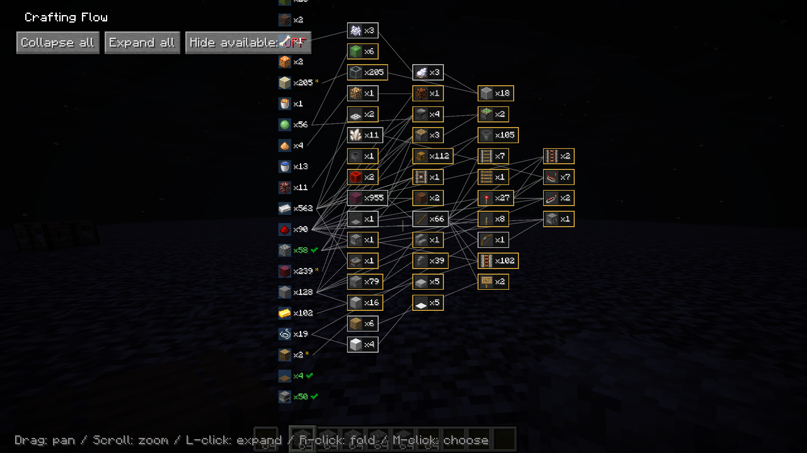

# Litematica RawMaterials

A [Litematica](https://github.com/sakura-ryoko/litematica) addon that expands the material list into raw materials.


Litematica's material list shows what a schematic is made of, but anything you'd normally craft (a block of redstone, a hopper, a chest) is listed as-is. RawMaterials follows the crafting recipes and shows the total raw materials you need to gather, minus what's already in your inventory.

## Requirements

Fabric, with [malilib](https://github.com/sakura-ryoko/malilib) and [Litematica](https://github.com/sakura-ryoko/litematica) for your Minecraft version:

| Minecraft | malilib | Litematica |
| --- | --- | --- |
| 26.3 | 0.30.2+ | 0.29.1+ |
| 26.2 | 0.29.0+ | 0.28.3+ |
| 26.1 – 26.1.2 | 0.28.9+ | 0.27.9+ |
| 1.21.11 | 0.27.16+ | 0.26.11+ |

Older versions are not supported because the Litematica subsystem this mod builds on (the recipe-decomposed material list) does not exist there.

## Usage

Press `M + K` to open the raw-material list. It uses the most recently opened Litematica material list; if none is open yet, it is generated automatically from the currently selected schematic placement (same as Litematica's `M + L`). The hotkey also works while a container screen is open (inventory, crafting table, chest), and `Esc` brings you back to it.

Press `M + J` to open the settings screen, where you can rebind both keys.

## Views

The list can be viewed in two ways. Expanded items, ignored items, tag choices, and the multiplier are shared between them, and the numbers are computed the same way in each, so switching views does not change the totals.

### Raw Material List

The main flat list, styled after Litematica's material list (Item / Total / Missing / Available columns, sortable).

- **Left-click** a row to expand it into its ingredients.
- **Right-click** a row to fold it back into the crafted item.
- **Shift + Right-click** a row to ignore it (removes it and everything it would be crafted into).
- **Middle-click** a tag row to pick which item to use.
- **Hold Tab** while hovering a row to see its crafting recipe.

The list also has a multiplier for building the schematic N times, a "Hide available" toggle, plain-text export, and an "Ignored: N" button that opens a menu where ignored items can be un-ignored one by one.

### Crafting Flow

Opened with the **Flow view** button. Item types are merged into a single left-to-right graph: raw materials on the left flow through intermediate crafts into the schematic's materials on the right. A shared ingredient like sticks appears only once, with an edge to every item that uses it.



- Same interactions as the list: left-click expand, right-click fold (a raw material folds into its consumer), Shift+right-click ignore, middle-click tag choice, Tab recipe.
- Counts are inventory-netted. Fully covered items get a green checkmark, partial stock shows `have/total`.
- Hovering a node highlights its paths: the materials it needs and everything it flows into.
- Drag to pan, scroll to zoom. Expand all / Collapse all / Hide available buttons are available here too.

## Features

### Recipe expansion

Crafted items are broken down into their ingredients, recursively, down to raw materials.

### Inventory netting

Items already in your inventory are subtracted, so the list shows what's actually left to gather. Fully covered branches stop expanding and turn green. This also applies to intermediate items: if you already have pistons in stock, their own materials are no longer requested, in every view.

### Tag ingredients

When a recipe accepts a tag (any planks, any log), you choose which item to count toward it.

### Ignoring items

Items you don't want counted, such as things you farm anyway, can be removed with Shift+right-click. Ignoring an item also removes the demand it would have created. Ignored items can be restored later from the ignored menu.

## Notes

Recipes come from your client's recipe book, the same source Litematica uses. On a vanilla multiplayer server, recipes you haven't unlocked won't expand, so some totals may not be fully broken down until you've unlocked them.

## Building

```sh
./gradlew build
```

This builds every supported Minecraft version ([Stonecutter](https://stonecutter.kikugie.dev/)); jars are written to `versions/<version>/build/libs/` (e.g. `versions/26.3.x/build/libs/rawmats-fabric-26.3-0.4.1.jar`). Put the jar in your `mods` folder along with malilib and Litematica for the same Minecraft version.
